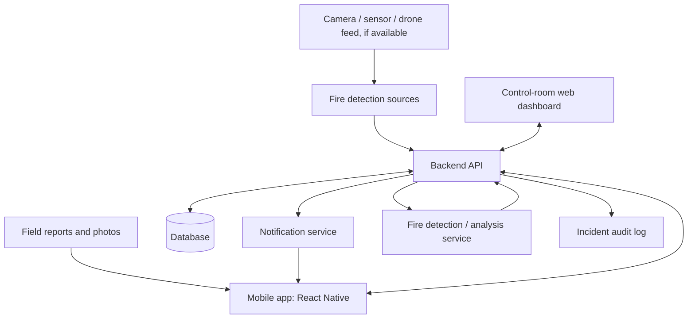
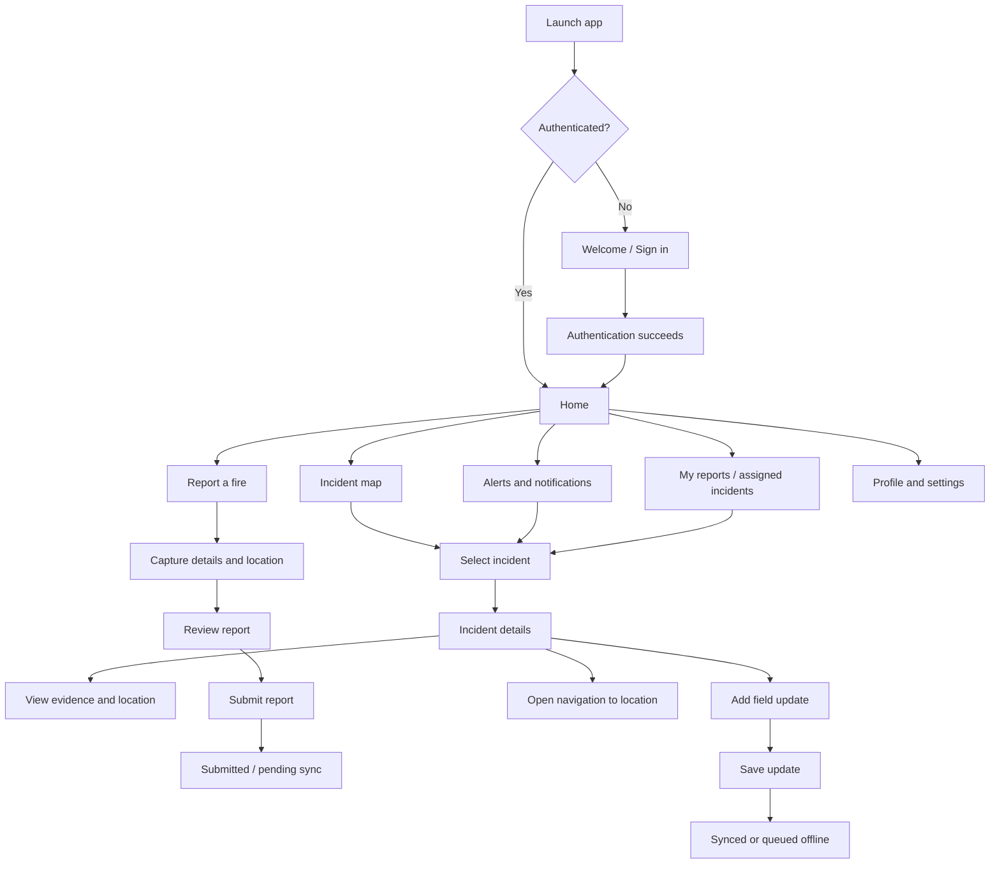
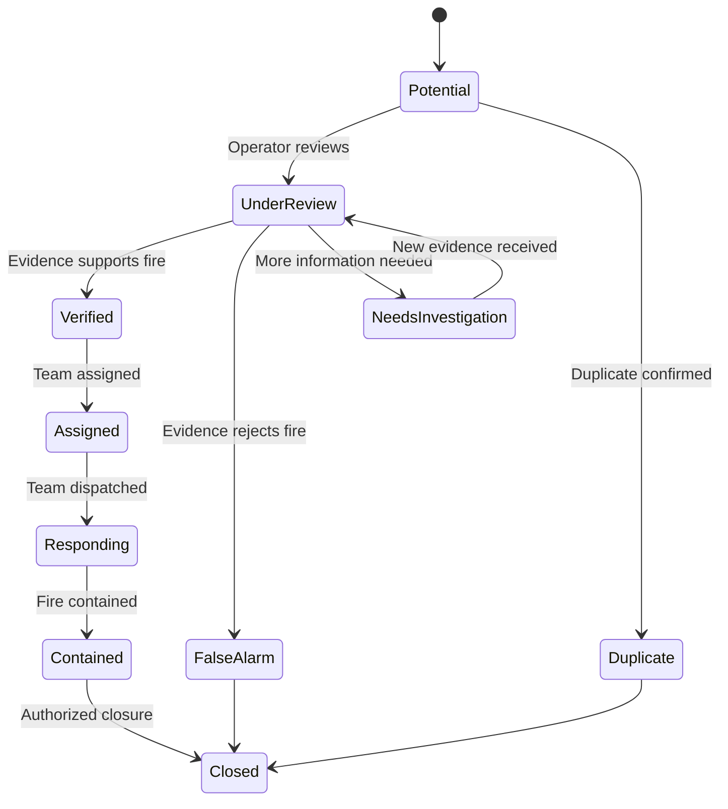
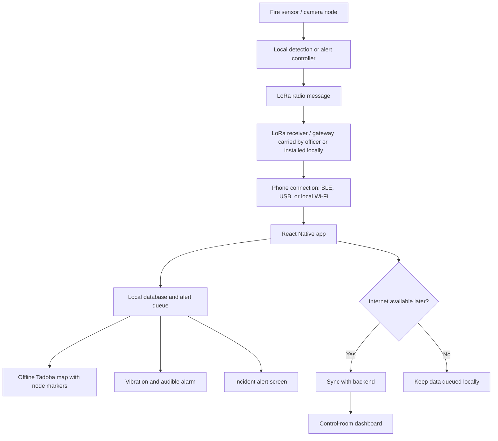

# Forest Fire Detection and Response — System Flow

## 1. Project objective

Build a system that detects potential forest fires early, identifies their location, and communicates useful, actionable information to the forest department for monitoring and response.

The system has two user-facing applications:

1. **Mobile app (React Native / Expo):** For forest officers, field staff, and optionally citizens to receive alerts, inspect incidents, report fires, and submit field updates.
2. **Main dashboard (Web):** For the control room to monitor incidents, review detection evidence, manage response, and see the overall fire situation.

Both applications use the **same backend, database, and incident records**.

---

## 2. High-level architecture

### Potential detection sources

- A field staff member or citizen reports smoke/fire through the mobile app.
- A camera or ESP32-CAM system sends images or metadata to a server when connectivity and power are available.
- A drone or other sensor system may submit observations when available.
- A future computer-vision model analyzes images and produces a **potential fire alert** with evidence and confidence information.

These sources are optional integrations. The app must still work for manual reporting if camera, drone, or sensor integrations are not ready.

### Connectivity assumption

The mobile app requires a network connection for live synchronization and push notifications. In low-connectivity forest areas, it should save reports locally and synchronize them when a connection returns. A live camera stream is not assumed to work everywhere.

LoRa is suitable for small messages such as sensor readings, alert IDs, or coordinates when the hardware and gateway are designed for it; it is not suitable for sending normal camera images or video. Store image evidence locally or transmit it over a suitable network when one is available.

---

## 3. User roles

### A. Citizen / public reporter (optional)

- Submit a suspected fire report.
- Share GPS location or select a location on a map.
- Attach a photo if available.
- View the submission status and receive appropriate updates.
- Cannot validate incidents, dispatch response teams, or view restricted operational information.

### B. Forest field staff / officer

- Sign in.
- Receive assigned or nearby incident alerts according to permissions.
- Open an incident and view its location, status, and evidence.
- Confirm, reject, or add field observations, depending on role permissions.
- Submit photos, notes, and status updates.
- Update progress while investigating or responding.
- Work offline where possible; pending actions synchronize later.

### C. Control-room operator / authorized administrator

- View all incidents permitted by their role.
- Review potential fire detections and incoming reports.
- Compare location, timestamp, image evidence, model confidence, and field reports.
- Mark an incident as verified, false alarm, duplicate, or requiring further investigation.
- Assign a response team and record dispatch details.
- Monitor incident status until closure.
- Manage users and permissions if granted administrator access.
- Review an audit history of important actions.

---

## 4. Mobile app — complete navigation flow

### Screen 1: Welcome and authentication

Purpose: establish the user's identity and permissions.

- App logo and short purpose statement.
- Sign in.
- Optional guest reporting, if the project permits public reports.
- Clear error messages for failed sign-in.
- Do not put privileged incident data behind an unauthenticated screen.

For a prototype, authentication can initially be mocked. Before real deployment, use secure authentication and role-based authorization on the backend.

### Screen 2: Home

Show a quick operational overview, not an overcrowded analytics dashboard.

Suggested sections:

- Current alert summary.
- High-priority or nearby incidents, based on available location permission.
- Recent notifications.
- Primary **Report Fire** action.
- Shortcut to the incident map.
- Assigned tasks for authorized staff.
- Network/sync status when offline.

Do not imply that an area is safe simply because no alerts are shown. Detection coverage may be incomplete.

### Screen 3: Incident map

- Display incidents that the signed-in user is authorized to see.
- Use map markers to distinguish potential, verified, false-alarm, and closed incidents.
- Provide list and map views.
- Allow users to select a marker to open incident details.
- Show last-updated time and location accuracy when available.
- Provide filters by status, severity, date, and assignment.
- Handle unavailable GPS, map tiles, and network access with clear fallbacks.

### Screen 4: Alerts and notifications

- List recent alerts and their timestamps.
- Display incident ID, status, approximate location, and priority.
- Open the relevant incident when tapped.
- Prevent duplicate notifications from repeatedly overwhelming the user.
- Distinguish automated detections from officer-verified incidents.
- Push notifications require network connectivity and user/device notification permissions.

### Screen 5: Report a fire

Suggested fields:

1. Location:
   - Use device GPS only after permission is granted.
   - Allow pin placement or manual location selection.
   - Record coordinates and location accuracy where available.
2. Observation:
   - Smoke, visible flames, burning vegetation, or other observation.
3. Photo:
   - Optional image evidence.
4. Time:
   - Capture submission time; preserve observation time if different.
5. Notes:
   - Optional description.
6. Reporter contact/identity:
   - Use the account identity where appropriate; avoid collecting unnecessary personal data.

Submission flow:

1. Validate required fields and coordinates.
2. Show a review screen.
3. Submit to the backend.
4. Receive a report/incident reference ID.
5. Show success only after the app knows whether the report was accepted by the server.
6. If offline, save it to a local pending queue and clearly label it **Not yet synced**.
7. Retry safely when connectivity returns; use an idempotency key or equivalent mechanism to avoid duplicate records.
8. Show the current status when it becomes available.

### Screen 6: Incident details

Display:

- Incident/report ID.
- Current status and priority.
- Coordinates, location accuracy, and map.
- Detection/report source.
- Observation and creation times.
- Image evidence, if available.
- AI result and confidence, if applicable, clearly labelled as an automated estimate.
- Assigned team and response notes, subject to permissions.
- Timeline of updates.
- Actions allowed for the current role.

Potential staff actions:

- Acknowledge alert.
- Add field observation.
- Upload evidence.
- Update investigation/response progress.
- Mark arrival at location.
- Recommend or record a status change if authorized.
- Open external navigation.

Only authorized roles can verify an incident, dismiss an alert, assign teams, or close an incident.

### Screen 7: My reports / assigned incidents

- List reports created by the user.
- List incidents assigned to the user, if their role supports assignments.
- Show pending upload/sync status separately from server incident status.
- Filter by status and date.
- Open each item to view its timeline and permitted actions.

### Screen 8: Profile and settings

- User details and role.
- Notification preferences.
- Location permission status.
- Sign out.
- App version and support information.
- Sync queue and last successful synchronization.
- Privacy information.

---

## 5. Incident lifecycle

Use a controlled state machine instead of allowing arbitrary status strings.

Recommended status meanings:

- **Potential:** A sensor/model or reporter has raised a possible fire.
- **Under review:** An authorized operator is checking the evidence.
- **Needs investigation:** More information is required.
- **Verified:** An authorized person has confirmed a fire incident.
- **Assigned:** A response team has been assigned.
- **Responding:** The team is investigating or responding on site.
- **Contained:** The fire has been reported as contained, pending any required confirmation.
- **False alarm:** The alert was reviewed and not considered a fire.
- **Duplicate:** The report refers to an already tracked incident.
- **Closed:** The incident has been closed by an authorized person.

Keep **report submission state** separate from **incident state**. For example, a report can be queued offline without yet existing on the server.

---

## 6. Backend and data flow

### Common data flow

1. A device, user, or detection service creates an observation.
2. The backend validates the request and permissions.
3. The backend stores the observation and any associated image reference.
4. Detection logic may generate a potential-fire event.
5. The backend creates or updates an incident after duplicate/association checks.
6. The control-room dashboard receives the updated incident through polling or a real-time channel.
7. Relevant users receive notifications where supported.
8. An officer submits new evidence or a field update.
9. The backend stores the update and audit record.
10. Both applications display the latest authorized state.

### Suggested core entities

- **User:** ID, display name, role, account status.
- **Observation:** ID, source, coordinates, accuracy, observation time, received time, notes, evidence references.
- **Incident:** ID, status, priority, location, first-seen time, last-updated time, verification details, assigned team.
- **Evidence:** ID, storage reference, media type, capture time, uploader/source, optional checksum.
- **Assignment:** incident ID, team/user ID, assigned time, assignment status.
- **IncidentUpdate:** incident ID, author, update type, notes, timestamp.
- **Notification:** recipient, incident ID, delivery/read state, timestamp.
- **AuditEvent:** actor, action, target, timestamp, and relevant change metadata.

Avoid storing large images directly in ordinary relational database rows. Store files in object/file storage and save secure references and metadata in the database.

### Suggested API outline

These are design examples, not existing endpoints.

- `POST /auth/...` — authentication, depending on the chosen auth provider.
- `GET /incidents` — list incidents permitted for the user.
- `GET /incidents/{id}` — incident details.
- `POST /reports` — submit a new field/public report.
- `POST /incidents/{id}/observations` — add an observation.
- `POST /incidents/{id}/evidence` — upload or register evidence.
- `POST /incidents/{id}/updates` — add a timeline update.
- `POST /incidents/{id}/assignments` — assign a team, restricted by role.
- `PATCH /incidents/{id}/status` — controlled status transition, restricted by role.
- `GET /notifications` — retrieve notifications.
- `GET /health` — service health check, without exposing sensitive data.

Choose a consistent API contract and validate request and response data. Enforce authorization in the backend; hiding a button in the app is not security.

---

## 7. Dashboard flow (for the later web application)

The dashboard should use the same API and data as the mobile app.

1. Authorized operator signs in.
2. Dashboard loads the incident summary and map.
3. Potential incidents appear in a review queue.
4. Operator opens an incident and reviews evidence and location.
5. Operator marks it for further investigation, verifies it, rejects it as a false alarm, or merges it as a duplicate.
6. For verified incidents, an authorized operator assigns a team and records dispatch.
7. Team members submit field updates through the mobile app.
8. Dashboard refreshes the incident timeline and map.
9. Authorized staff record containment and close the incident.
10. The audit trail preserves important status and assignment changes.

Suggested dashboard sections:

- Overview / incident counts.
- Live incident map.
- Alert review queue.
- Incident details and evidence.
- Response team assignments.
- Incident history and audit trail.
- User and role management (admin only).
- System/device health, if sensor integrations exist.

“Live” updates require polling, server-sent events, WebSockets, or another chosen synchronization mechanism. Do not claim real-time operation until it is implemented and tested.

---

## 8. Offline and poor-connectivity behavior

Forest coverage can be unreliable, so offline behavior needs to be deliberate.

When offline, the mobile app should:

- Keep previously synced incident details available where safe and appropriate.
- Allow a report or field update to be saved locally.
- Show **Pending sync** clearly.
- Preserve capture/observation time and local queue order.
- Retry uploads when connectivity returns.
- Avoid creating duplicate reports when retries occur.
- Show sync errors and allow a retry.
- Avoid showing stale cached information as current.

When online again:

1. Reconnect to the backend.
2. Authenticate/refresh the session as needed.
3. Upload queued reports and evidence.
4. Reconcile server responses and duplicate conflicts.
5. Refresh incident statuses and assignments.
6. Mark successfully uploaded queue items as synced.

Offline support is not the same as offline push notifications: normal remote push notifications generally need a network connection.

---

## 9. Security, safety, and reliability requirements

- Enforce role-based access control in the backend.
- Use HTTPS for network traffic.
- Store authentication tokens securely on the device.
- Request GPS, camera, photo, and notification permissions only when needed.
- Restrict access to sensitive forest locations and operational data where appropriate.
- Validate uploaded file type and size; do not trust file extensions alone.
- Keep an audit trail for verification, dismissal, assignment, and closure.
- Treat AI confidence as a signal for review, not proof of a fire.
- Provide a way to report a detection failure or incorrect location.
- Do not promise guaranteed fire detection or emergency response.
- Provide clear contact/escalation instructions approved by the responsible department.
- Back up server data and monitor API/storage health before real deployment.

---

## 10. Suggested implementation order

Build the mobile app first, but define the shared data contract before building many screens.

### Phase 1 — Mobile UI prototype

- Set up React Native with Expo and TypeScript.
- Add navigation and a consistent component structure.
- Build sign-in, home, incident list/map, alerts, report form, incident details, and profile.
- Use clearly labelled mock data.
- Test loading, empty, error, permission-denied, and offline states.

### Phase 2 — Backend contract and persistence

- Choose backend technology and database.
- Define users, roles, reports, incidents, evidence, updates, and statuses.
- Implement authentication and authorization.
- Implement report creation, incident retrieval, and updates.
- Add image upload and storage references.
- Add validation, audit logging, and basic tests.

### Phase 3 — Connect the mobile app

- Replace mock data with API calls.
- Add secure authentication handling.
- Add GPS and image capture with permission/error handling.
- Add local pending queue and retry-safe synchronization.
- Add notifications if the infrastructure is ready.

### Phase 4 — Detection integration

- Define the interface for camera/sensor/drone observations.
- Send images through a suitable network when available.
- Run the fire detection model on the server or an appropriate edge device.
- Store the result, timestamp, coordinates, confidence, and evidence reference.
- Create a potential incident for review.
- Test false positives, false negatives, poor lighting, smoke, and non-fire lookalikes.

### Phase 5 — Main dashboard

- Build the web dashboard against the same backend.
- Add map, review queue, evidence viewer, incident lifecycle, and team assignment.
- Add real-time updates only if implemented.
- Test concurrent updates from dashboard and mobile.

### Phase 6 — End-to-end validation

Test scenarios including:

- Manual report with GPS.
- Report without GPS permission.
- Image upload failure.
- Offline report followed by successful synchronization.
- Two reports for the same fire.
- False alarm and verified incident.
- Unauthorized status update attempt.
- Officer assignment and field progress updates.
- Detection service unavailable.
- Dashboard disconnected and reconnected.

---

## 11. Recommended initial technology choices

Keep the first version small. Avoid adding complex infrastructure before the core workflow works.

- **Mobile:** React Native + Expo + TypeScript.
- **Navigation:** Expo Router.
- **Backend:** FastAPI or another backend you can maintain confidently.
- **Database:** PostgreSQL for users, incidents, assignments, and updates.
- **Image storage:** Object storage or a suitable file-storage service; use local development storage initially if needed.
- **Maps:** A map SDK/provider with documented mobile support and a suitable usage policy.
- **Notifications:** A push notification service once backend events are reliable.
- **Detection:** A separate inference module/service, initially mocked until the model and hardware are ready.
- **Dashboard:** A web frontend using the same backend API.

These are recommendations, not requirements. Confirm hosting, offline constraints, map licensing, and departmental deployment rules before production.

---

## 12. MVP acceptance checklist

The first usable prototype is complete when:

- [ ] A user can navigate all primary mobile screens.
- [ ] A user can submit a fire report with a location and optional photo.
- [ ] The app clearly distinguishes submitted, failed, and pending-sync reports.
- [ ] Reports are persisted by the backend.
- [ ] An authorized operator can view reports on the dashboard.
- [ ] Potential alerts can be reviewed and given a controlled status.
- [ ] Authorized staff can add field updates.
- [ ] Incident changes are visible in both applications after synchronization.
- [ ] Duplicate submissions and failed network requests are handled safely.
- [ ] Role restrictions and audit records are tested.
- [ ] The UI does not imply that automated detections are confirmed fires.

---

## 13. Scope boundaries for the first version

Do not make these prerequisites for the initial mobile prototype:

- A working drone.
- A live video stream from every forest location.
- LoRa image/video transfer.
- A highly accurate production fire-detection model.
- Full offline maps for every region.
- Automated emergency dispatch without human verification.

Use mock detection events and mock incidents while building the app. Then replace each mock integration with a tested service. The essential first milestone is a dependable reporting and incident-management workflow.

---

## 14. Critical requirement: offline-first Tadoba field operation

**Design target:** The mobile app must continue to show the preloaded Tadoba map, known monitoring nodes, previously synchronized incident data, GPS position, and locally received alerts when mobile data and Wi-Fi internet are unavailable.

This does **not** mean a phone can receive new alerts from a distant sensor with no communication path. Every new alert must reach the phone through a working local communication link.

### Offline capability matrix

| Feature | Works with no internet? | Requirement / limitation |
|---|---|---|
| Show Tadoba map | Yes | Map area and required zoom levels must be downloaded and stored before deployment. |
| Show all configured node markers | Yes | Node IDs, coordinates, types, and metadata must be stored locally. |
| Show the phone's GPS position | Usually | GPS can work without internet; satellite reception and accuracy vary under dense canopy. |
| Browse last-synced incidents | Yes | Clearly label data freshness and last synchronization time. |
| Create a report | Yes | Save locally and mark it **Pending sync**. |
| Send a new report to the control room | No, not via internet | Queue it until internet or a separate radio/data link is available. |
| Receive a new remote alert | Only with a local communication path | For example, a LoRa receiver/gateway linked to the phone, or a local network. |
| Vibrate and play an alert sound | Yes, once the alert reaches the phone | Requires app/native platform configuration, permissions, and appropriate foreground/background handling. |
| Show live node status | Only if node updates are received | Otherwise show last-known status and its age, not a misleading live/healthy status. |
| Show live camera images/video | Not automatically | Image/video requires a suitable bandwidth-capable connection. LoRa is for small messages, not normal image/video transfer. |

---

## 15. Recommended field communication architecture

For a forest with no internet, design the system around **local alert delivery first**, with internet synchronization as a secondary path.

### Important hardware boundary

A normal Android phone does not have a built-in LoRa radio. A LoRa-based deployment needs a compatible receiver/gateway and a defined link from that device to the phone, such as Bluetooth Low Energy (BLE), USB, or a local Wi-Fi access point. The receiver/gateway, message format, power supply, radio range, antenna placement, and forest coverage must be tested in the field.

A LoRa message should contain compact data such as:

- Protocol version and message type.
- Node ID and unique alert/event ID.
- Latitude and longitude, if the node has location information.
- Detection timestamp or device time.
- Alert type and severity.
- Optional model confidence and battery/signal metadata.
- Sequence number and integrity check.

Do not send photos or video over LoRa. Keep evidence on the camera/node until a suitable connection is available, or use a separate higher-bandwidth link.

### Redundancy and reliability

- Give each alert a unique ID so retries do not create repeated incidents.
- Add a sequence number and message integrity check.
- Acknowledge receipt to the gateway when the radio protocol supports it.
- Retry or repeat important alert messages according to the radio protocol.
- Show whether the phone received an alert from a node/gateway and when.
- Store received alerts locally before displaying them.
- If possible, make the gateway retain events until they are acknowledged.
- Define behavior for gateway battery failure, radio loss, and phone battery failure.
- Do not claim end-to-end delivery until it has been tested across the actual field hardware.

---

## 16. Offline map and Tadoba node data

### Data prepared before entering the forest

Package or download the following for the operational area:

1. **Offline map data:** the Tadoba operational boundary, required roads/tracks, geographic features, and the map tiles or vector data needed at the selected zoom levels.
2. **Node registry:** stable node ID, name, type, latitude, longitude, operational area/compartment, and other approved metadata.
3. **Forest boundaries:** approved compartment, range, beat, or patrol-zone boundaries where available.
4. **Last synchronized incidents:** only the records the signed-in user is authorized to access and that are appropriate to retain on-device.
5. **Map package metadata:** version, creation time, geographic coverage, zoom levels, and checksum/version identifier.

The phrase “all nodes” must mean all nodes in the department's verified node registry, not arbitrary points invented for the UI. Obtain real coordinates from the deployment plan or survey. Mock coordinates can be used in development, but label them clearly as mock data.

### Node marker states

Use a legend that can be understood quickly in the field. Suggested states:

- **Alert:** a fire-related event has been received.
- **Online / recently heard:** a recent heartbeat or message was received within the configured freshness window.
- **Stale:** the last update is older than the configured freshness threshold.
- **Offline / not heard:** no message has been received within the configured threshold, or the node is known to be unavailable.
- **Unknown:** the app has no trustworthy status information.
- **Maintenance:** explicitly marked by an authorized operator.

The freshness threshold should be configurable according to expected node reporting intervals. Do not hard-code an arbitrary interval without defining the node protocol.

### Map behavior

- Open directly into a map of the Tadoba operational area.
- Show the officer's GPS location and accuracy when available.
- Show all locally registered nodes even when disconnected.
- Cluster markers at broad zoom levels; separate them when zoomed in.
- Selecting a node opens a bottom sheet with ID, type, coordinates, last-seen time, status, and recent events.
- Selecting an alert marker opens its incident details.
- Show an offline indicator and the map package's version/date.
- Never make a stale node appear live.
- Include a list view as a fallback for small screens or crowded maps.

### Map licensing and packaging

Choose an offline-capable map renderer and data source whose license and terms permit the intended offline use. Download or package only the geographic coverage and zoom levels required for Tadoba; offline tiles can consume substantial device storage. Test map rendering with mobile data and Wi-Fi disabled before field deployment.

---

## 17. Local alert, vibration, and sound behavior

### Required alert flow

1. The app receives a valid event from the local gateway, or an alert is generated locally on the device.
2. Validate the message and check its unique event ID.
3. Persist the event to local storage immediately.
4. Determine whether it is new, repeated, acknowledged, or already closed.
5. For a new high-priority event, trigger the configured vibration and audible alarm.
6. Display a full-screen or prominent alert UI when platform rules allow; otherwise display a high-priority notification and open the alert screen when tapped.
7. Show the source node, event time, location, distance from the officer if a reliable location is available, and the last map/node update time.
8. Let the officer acknowledge the alert. Acknowledgement stops or silences the local alarm according to policy but does not erase the event.
9. Keep the alert visible in the incident list until resolved.
10. Sync the alert to the server and dashboard when connectivity becomes available.

### Android implementation notes

- Plan for an Android-first field deployment if continuous background alarm behavior is essential.
- Expo Go alone may not support every native/background requirement. Use an Expo development build and appropriate native modules/configuration where necessary.
- Configure notification channels and sound/vibration settings. Ask for notification permissions where required.
- Test behavior with the app in the foreground, background, screen locked, battery saver enabled, and after the operating system reclaims the process.
- If a persistent connection to a BLE gateway is required, implement and test the required Android BLE permissions and background/foreground-service strategy.
- Do not assume an ordinary timer or JavaScript-only loop will continue reliably while the app is backgrounded or terminated.
- Respect OS sound settings, Do Not Disturb, user permissions, and device policies. If a dedicated emergency sound is required, validate the permitted Android mechanism on the target devices.
- A normal app cannot guarantee that it will override every silent mode, Do Not Disturb setting, force-stop, battery restriction, or hardware failure. Document and test the deployment configuration.
- Test alarm duration, repeat interval, acknowledgement, duplicate suppression, and low-battery behavior with field users.

### Alarm acknowledgement policy

Define this with the forest department before deployment. A reasonable starting policy is:

- New high-priority alert: sound and vibrate.
- Repeated copy of the same event: update the event, but do not restart the alarm endlessly.
- Unacknowledged alert: repeat according to a configured escalation policy.
- Acknowledged alert: silence the local alarm but retain the visible alert and audit event.
- New distinct high-priority alert: alarm again.
- False alarm or closure received later: update the incident; preserve the event history.

The mobile alarm only confirms that the **phone received an alert**. It does not prove the fire is real or that other officers received the same alert.

---

## 18. Revised mobile screen design direction

Use the provided ride-booking screenshots as structural inspiration, not as literal forest-app designs.

### Home / offline map screen

- Full-screen Tadoba map as the main surface.
- Compact top status area: **OFFLINE MODE**, GPS status, and last sync time.
- Small floating map controls: locate me, zoom, layers, and node filters.
- Map markers for nodes and incidents.
- Bottom sheet that can expand/collapse:
  - Current alert summary.
  - Nearest or selected node details.
  - Recent incidents.
  - A highly visible **Report Fire** action.
- A compact node legend accessible without hiding most of the map.

### Active alert screen

- Strong visual distinction for a new, unacknowledged alert.
- Large “POTENTIAL FIRE ALERT” heading rather than an unsupported claim that a fire is confirmed.
- Node/alert ID, received time, coordinates, and location accuracy.
- Map preview focused on the alert location.
- Clear **Acknowledge / Silence alarm** action.
- Secondary actions to view directions, add an observation, or attach evidence.
- Visible status such as **Received locally — not synced to control room** when appropriate.

### Node details bottom sheet

- Node name and unique ID.
- Status and last-heard timestamp.
- Distance/bearing from the officer only if computed from reliable coordinates.
- Recent alert history.
- Coordinates and copy/share coordinate action, if permitted.
- Clear distinction between the node's reported state and the phone's last-known data.

### Visual direction

- Field-oriented, high-contrast UI with readable text in sunlight.
- Forest-inspired neutral greens for ordinary map/interface elements.
- Amber for needs-review and red for active high-priority alerts, with labels/icons as well as color.
- Large touch targets suitable for quick use outdoors.
- Avoid decorative cards that cover the map or make alert status hard to find.
- Keep critical status and alarm acknowledgement usable with one hand.

---

## 19. Offline-first implementation sequence

1. **Create a static map prototype:** render an offline-capable map package covering Tadoba and display a GPS marker.
2. **Load the node registry:** use a local JSON/SQLite dataset with verified coordinates; show all nodes and their last-known status.
3. **Implement node details:** select a marker to open the bottom sheet.
4. **Implement local reports:** save report details and photos locally, with a visible pending-sync queue.
5. **Implement local alert simulation:** inject a test alert event into the app and verify storage, map focus, vibration, sound, acknowledgement, and duplicate suppression without internet.
6. **Connect the radio gateway:** define and implement the BLE/USB/local-network protocol, then test with the actual receiver hardware.
7. **Test background delivery:** screen locked, app backgrounded, low battery, reconnects, and OS restrictions on the exact target phones.
8. **Add backend synchronization:** upload queued reports and received alerts when internet returns.
9. **Connect the control-room dashboard:** synchronize incident status, assignments, and audit history.
10. **Field test:** verify map coverage, node coordinates, radio range, dead zones, battery life, alert latency, and false-alarm handling in the real operational area.

### Offline MVP acceptance criteria

- [ ] Map of the defined Tadoba area opens with all required map data while the phone has no internet.
- [ ] Every registered node in the supplied registry appears at its correct coordinates.
- [ ] The app distinguishes online/recent, stale, offline, and unknown node states.
- [ ] GPS position can be shown without internet where satellite reception is available.
- [ ] A manual report can be saved offline without being falsely marked as uploaded.
- [ ] A test alert delivered over the selected local communication link is saved and shown on the map without internet.
- [ ] The configured sound and vibration trigger for a new alert under tested device conditions.
- [ ] Acknowledging an alert silences the local alarm according to policy without deleting the event.
- [ ] Duplicate messages do not produce duplicate incidents or endless alarm loops.
- [ ] Queued data synchronizes safely when connectivity returns.
- [ ] The UI clearly shows when an alert has not yet reached the control-room backend.
- [ ] The field team has tested failure cases including gateway loss, phone battery loss, stale node data, and GPS uncertainty.
